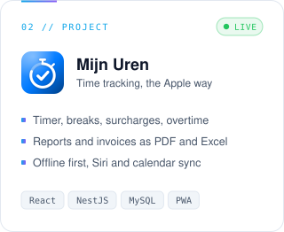
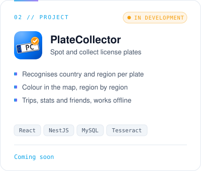
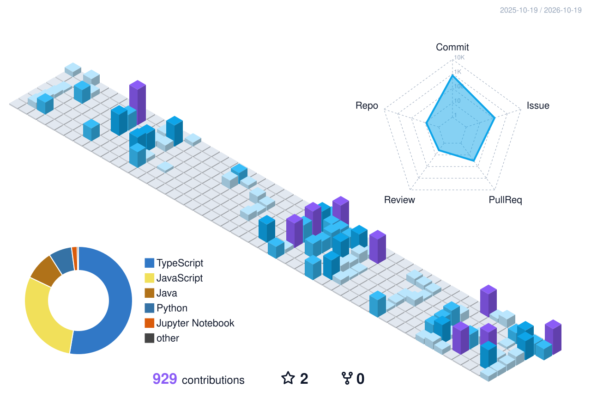
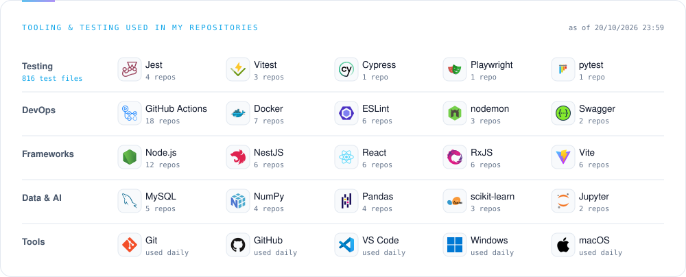

<a href="https://rafvanhooijdonk.nl">
<picture>
  <source media="(prefers-color-scheme: dark)" srcset="./assets/hero-dark.svg" />
  <source media="(prefers-color-scheme: light)" srcset="./assets/hero-light.svg" />
  
</picture>
</a>

  
  
  

### `01 // Stack`

<picture>
  <source media="(prefers-color-scheme: dark)" srcset="./assets/stack-dark.svg" />
  
</picture>

<picture>
  <source media="(prefers-color-scheme: dark)" srcset="./assets/divider-dark.svg" />
  
</picture>

### `02 // Projects`

  <a href="https://alpha-stock.com"><picture>
    <source media="(prefers-color-scheme: dark)" srcset="./assets/card-alphastock-dark.svg" />
    
  </picture></a>
  <a href="#02--projects"><picture>
    <source media="(prefers-color-scheme: dark)" srcset="./assets/card-mijn-uren-dark.svg" />
    
  </picture></a>
  <a href="#02--projects"><picture>
    <source media="(prefers-color-scheme: dark)" srcset="./assets/card-platecollector-dark.svg" />
    
  </picture></a>

<picture>
  <source media="(prefers-color-scheme: dark)" srcset="./assets/divider-dark.svg" />
  
</picture>

### `03 // Activity`

<a href="./STATS.md">
<picture>
  <source media="(prefers-color-scheme: dark)" srcset="./assets/stats-dark.svg" />
  
</picture>
</a>

<a href="./STATS.md">
<picture>
  <source media="(prefers-color-scheme: dark)" srcset="./assets/tools-dark.svg" />
  
</picture>
</a>

<picture>
  <source media="(prefers-color-scheme: dark)" srcset="https://raw.githubusercontent.com/RafvanHooijdonk/RafvanHooijdonk/output/github-snake-dark.svg" />
  <source media="(prefers-color-scheme: light)" srcset="https://raw.githubusercontent.com/RafvanHooijdonk/RafvanHooijdonk/output/github-snake.svg" />
  
</picture>
